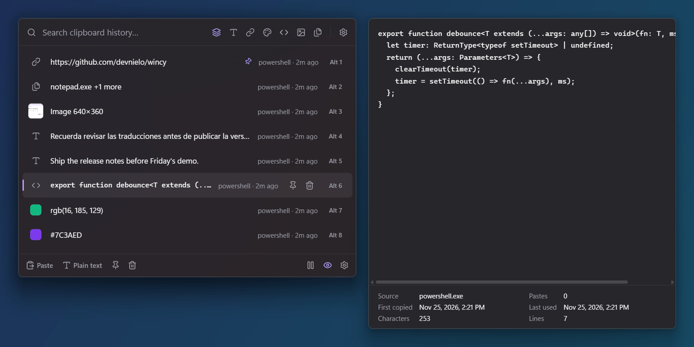

<p align="center">
  
</p>

<h1 align="center">Wincy</h1>

<p align="center">
  <b>El gestor de portapapeles para Windows que se usa con el teclado.</b><br>
  Pulsa <kbd>Alt</kbd>+<kbd>V</kbd>, escribe y pulsa <kbd>Enter</kbd>. Rápido, privado y de código abierto.
</p>

<p align="center">
  <a href="https://github.com/devnielo/wincy/releases/latest"></a>
  <a href="https://github.com/devnielo/wincy/actions/workflows/ci.yml"></a>
  <a href="LICENSE"></a>
  <a href="https://buymeacoffee.com/devnielo"></a>
</p>

<p align="center">
  <a href="README.md">English</a> · Español
</p>

<p align="center"></p>

## Características

- **Se abre donde estás:** la paleta de comandos aparece junto al cursor del ratón, no en una esquina de la pantalla.
- **Todo lo que copias:** texto, texto enriquecido (HTML), imágenes, listas de archivos, URL, colores y código, detectados y etiquetados automáticamente.
- **Búsqueda difusa** por contenido y aplicación de origen, con filtros rápidos por tipo (<kbd>Tab</kbd>) y un filtro `app:` (`app:chrome`).
- **Busca dentro de las imágenes:** el texto de las capturas de pantalla y otras imágenes copiadas se lee con el OCR que trae Windows, en tu PC, así que la búsqueda también las encuentra.
- **Pega en cualquier sitio:** <kbd>Enter</kbd> pega directamente en la aplicación que estabas usando; <kbd>Shift</kbd>+<kbd>Enter</kbd> pega como texto sin formato.
- **Pegado rápido:** <kbd>Alt</kbd>+<kbd>1</kbd>…<kbd>9</kbd> pega el elemento visible número N.
- **Fijados:** los elementos fijados se conservan siempre y nunca se recortan del historial.
- **Panel de vista previa flotante** junto a la paleta (a la derecha o a la izquierda, donde quepa) que muestra completo el elemento seleccionado o bajo el ratón: textos largos, código, imágenes, colores y listas de archivos, con scroll.
- **También con el ratón:** arrastra la paleta desde la barra de búsqueda; cada atajo tiene su botón: pegar, texto plano, fijar, eliminar, pausar la captura, vista previa y ajustes.
- **Privado por diseño:** todo en local; ignora los gestores de contraseñas, el contenido marcado como sensible y el texto que parece un secreto (claves privadas, tokens de API, números de tarjeta); puedes pausar la captura desde la bandeja y, si quieres, hacer que los elementos antiguos caduquen tras unos días.
- **Ligero:** captura por eventos (sin sondeo), efecto translúcido nativo de Windows (Mica / Acrylic) y un binario Tauri pequeño.
- **A tu gusto:** tema del sistema, claro u oscuro y un color de énfasis (el de Windows por defecto, u otro de siete).
- **Actualizaciones automáticas firmadas** e interfaz en inglés y español.

## Instalación

1. Descarga el instalador más reciente (`*_x64-setup.exe`) desde [Releases](https://github.com/devnielo/wincy/releases/latest).
2. Ejecútalo. Se instala solo para tu usuario; no necesita permisos de administrador.
3. Wincy se inicia en la bandeja del sistema. Pulsa <kbd>Alt</kbd>+<kbd>V</kbd>.

> **¿"Windows protegió su PC"?** El instalador todavía no está firmado con un certificado de firma de código de pago, así que SmartScreen puede mostrar un aviso. Haz clic en **Más información → Ejecutar de todas formas**. Si lo prefieres, [compílalo tú mismo](#compilar-desde-el-código-fuente).

Wincy busca actualizaciones al iniciarse (puedes desactivarlo en Ajustes). Las actualizaciones están firmadas y se verifican antes de instalarse.

Requiere Windows 10 u 11 (x64). WebView2 ya viene incluido en Windows 10/11.

## Uso

Copia como siempre. Cuando necesites algo de nuevo, pulsa <kbd>Alt</kbd>+<kbd>V</kbd> (configurable), escribe unas letras y pulsa <kbd>Enter</kbd>.

### Atajos de teclado

| Teclas | Acción |
|---|---|
| <kbd>Alt</kbd>+<kbd>V</kbd> | Abrir la paleta (global, configurable) |
| *escribir* | Filtrar (búsqueda difusa) por contenido (también el texto de las imágenes), aplicación de origen o tipo; `app:nombre` deja solo lo copiado desde esa aplicación |
| <kbd>↑</kbd> / <kbd>↓</kbd>, <kbd>RePág</kbd> / <kbd>AvPág</kbd>, <kbd>Inicio</kbd> / <kbd>Fin</kbd> (<kbd>Ctrl</kbd>+<kbd>Inicio</kbd> / <kbd>Fin</kbd>) | Mover la selección |
| <kbd>Enter</kbd> | Pegar |
| <kbd>Shift</kbd>+<kbd>Enter</kbd> | Pegar como texto sin formato |
| <kbd>Alt</kbd>+<kbd>1</kbd> … <kbd>Alt</kbd>+<kbd>9</kbd> | Pegar el elemento visible número N (los fijados van primero, así que <kbd>Alt</kbd>+<kbd>1</kbd> es el primer fijado) |
| <kbd>Ctrl</kbd>+<kbd>P</kbd> | Fijar / desfijar |
| <kbd>Ctrl</kbd>+<kbd>Supr</kbd> | Eliminar el elemento |
| <kbd>Tab</kbd> / <kbd>Shift</kbd>+<kbd>Tab</kbd> | Cambiar el filtro de tipo: todo → texto → url → color → código → imagen → archivos |
| <kbd>Ctrl</kbd>+<kbd>Espacio</kbd> | Mostrar / ocultar la vista previa |
| <kbd>Ctrl</kbd>+<kbd>,</kbd> | Abrir los ajustes |
| <kbd>Esc</kbd> | Borrar la búsqueda; si está vacía, cerrar la paleta (en ajustes: volver a la paleta) |

El menú del icono de la bandeja permite abrir la paleta o los ajustes, pausar la captura, borrar el historial (los fijados se conservan) o salir.

Si desactivas **Pegar en la aplicación activa** en Ajustes, Wincy solo copia el elemento al portapapeles y lo pegas tú.

Si otro programa ya usa tu atajo, Wincy no puede registrarlo: al arrancar abre los Ajustes con un aviso (y la descripción del icono de la bandeja indica que el atajo no está disponible) para que grabes otro.

### Búsqueda

Escribe unas letras de cualquier cosa del elemento: su texto, el texto que Wincy encontró en una imagen, la aplicación de origen o el tipo. Añade `app:<nombre>` para quedarte solo con lo copiado desde aplicaciones cuyo nombre contiene `<nombre>` (sin distinguir mayúsculas y sin `.exe`); repítelo para admitir varias aplicaciones.

| Búsqueda | Encuentra |
|---|---|
| `factura` | elementos que contienen algo parecido a "factura", también capturas de una |
| `app:code debounce` | "debounce" en lo copiado desde VS Code (`Code.exe`) |
| `app:chrome app:edge` | todo lo copiado desde Chrome o Edge |

El texto de las imágenes se reconoce en segundo plano con el motor OCR de Windows, en uno de tus idiomas de visualización de Windows; no se sube nada. Si no hay ningún idioma de OCR instalado, las imágenes se guardan igual, pero no se pueden buscar por su texto. Para desactivarlo, usa Ajustes → **Reconocer texto en imágenes**.

## Privacidad

Tu historial del portapapeles nunca sale de tu equipo: sin cuentas, sin nube, sin telemetría. La única petición de red que hace Wincy es la comprobación de actualizaciones en GitHub Releases, que puedes desactivar.

Wincy **no** captura:

- el contenido que la aplicación de origen marca como privado con los formatos estándar del portapapeles de Windows `ExcludeClipboardContentFromMonitorProcessing`, `Clipboard Viewer Ignore` o `CanIncludeInClipboardHistory = 0` (lo hacen Bitwarden, 1Password, KeePassXC y los navegadores en modo privado);
- nada copiado desde una aplicación de la lista de **aplicaciones ignoradas**. Por defecto: Bitwarden, 1Password, KeePass, KeePassXC, Enpass, Dashlane, LastPass, NordPass y Proton Pass. Añade las tuyas en Ajustes por nombre de ejecutable (p. ej. `miboveda.exe`);
- el texto que **parece un secreto** (activado por defecto; Ajustes → **Ignorar datos confidenciales**): una clave privada PEM, un JSON Web Token, identificadores de clave de acceso de AWS, claves de GitHub, Slack, Stripe (en producción), Google API, OpenAI y Anthropic, o un número de tarjeta de pago (comprobado con el algoritmo de Luhn). Solo reconoce estos formatos exactos, así que el texto normal nunca se descarta por error; no garantiza que se detecte cualquier secreto;
- nada en absoluto mientras la captura esté **pausada** desde el menú de la bandeja.

Los elementos fijados se conservan hasta que los eliminas. El resto se recorta al tamaño de historial que elijas (1000 elementos por defecto) y, si eliges un plazo en Ajustes → **Borrar elementos antiguos**, se borra cuando lleva ese número de días sin copiarse ni pegarse (de 1 a 365; desactivada por defecto).

### Dónde se guardan tus datos

| Qué | Dónde |
|---|---|
| Base de datos del historial | `%APPDATA%\dev.wincy.app\wincy.db` (SQLite) |
| Imágenes copiadas y miniaturas | `%APPDATA%\dev.wincy.app\images\` |
| Ajustes | `%APPDATA%\dev.wincy.app\settings.json` (la carpeta de configuración de la app) |
| Registros (logs) | `%LOCALAPPDATA%\dev.wincy.app\logs\` (rotan al llegar a 1 MB aprox.; nunca contienen lo que copias) |

**Ajustes → Abrir carpeta de datos** la abre en el Explorador. **Borrar historial** elimina todo excepto los elementos fijados. El texto reconocido en las imágenes se guarda con el elemento en la misma base de datos.

## Informar de un error

Wincy escribe un archivo de registro (consulta la tabla anterior; Ajustes → **Abrir carpeta de registros** la abre). El registro anota lo que ocurre, como una captura descartada o un atajo que no se pudo registrar, pero nunca lo que copias: ni el contenido de los elementos ni el texto reconocido.

Cuando [abras un informe de error](https://github.com/devnielo/wincy/issues/new?template=bug_report.yml), pulsa **Ajustes → Copiar diagnóstico** y pega el resultado. Incluye la versión de Wincy, la versión y compilación de Windows, tus ajustes (las aplicaciones ignoradas, solo su número), el número de elementos, si el OCR está disponible y las últimas ~200 líneas del registro. Léelo antes de publicarlo.

## Desinstalación

Configuración de Windows → Aplicaciones → Aplicaciones instaladas → **Wincy** → Desinstalar. El desinstalador ofrece borrar también los datos de la aplicación; para hacerlo a mano, elimina `%APPDATA%\dev.wincy.app` y `%LOCALAPPDATA%\dev.wincy.app`.

## Compilar desde el código fuente

Requisitos:

- [Rust](https://rustup.rs/) estable con la toolchain MSVC (`x86_64-pc-windows-msvc`; necesita la carga de trabajo "Desarrollo para el escritorio con C++" de Visual Studio Build Tools)
- [Node.js](https://nodejs.org/) 22.23.4 o superior (LTS actual)
- [pnpm](https://pnpm.io/installation)
- WebView2 (preinstalado en Windows 10/11)

```powershell
git clone https://github.com/devnielo/wincy.git
cd wincy
pnpm install
pnpm tauri dev      # ejecutar con recarga en caliente
pnpm tauri build    # instalador en src-tauri/target/release/bundle/nsis/
```

`pnpm tauri build` firma los artefactos del actualizador, así que necesita `TAURI_SIGNING_PRIVATE_KEY`. Para una compilación local, crea tu propia clave con `pnpm tauri signer generate -w "$env:USERPROFILE\.tauri\local.key"` y asigna a la variable el contenido de ese archivo. Una compilación firmada con tu propia clave no aceptará las actualizaciones oficiales.

## Estructura del proyecto

```
├── src/                 frontend React + TypeScript (paleta, ajustes)
├── src-tauri/           backend Rust (Tauri v2)
│   └── src/             escucha del portapapeles, almacenamiento SQLite, pegado, ventana, bandeja, ajustes
├── website/             sitio web Astro (GitHub Pages)
├── assets/logo.svg      logo maestro (los iconos de la app se generan a partir de él)
├── docs/
│   ├── ARCHITECTURE.md  contrato entre backend y frontend: comandos, eventos, tipos
│   ├── RELEASING.md     cómo se generan las versiones y las actualizaciones automáticas
│   └── SIGNING.md       firma Authenticode mediante SignPath Foundation
├── packaging/winget/    plantillas del manifiesto de winget
└── .github/             flujos de CI, release y Pages; plantillas de issues
```

## Tecnologías

- [Tauri v2](https://tauri.app/) y Rust: escucha del portapapeles Win32 (`AddClipboardFormatListener`), [rusqlite](https://github.com/rusqlite/rusqlite) (SQLite incluido), [enigo](https://github.com/enigo-rs/enigo) para pegar, [window-vibrancy](https://github.com/tauri-apps/window-vibrancy)
- React 19 y TypeScript, [HeroUI](https://www.heroui.com/), [Tailwind CSS 4](https://tailwindcss.com/), [TanStack Virtual](https://tanstack.com/virtual), [Fuse.js](https://www.fusejs.io/), [Zustand](https://zustand.docs.pmnd.rs/), iconos [Lucide](https://lucide.dev/)
- Instalador NSIS con actualizaciones automáticas firmadas mediante `tauri-plugin-updater`

## Ideas para el futuro

Direcciones, no promesas. Abre un issue para hablarlo antes de empezar a trabajar.

- Fragmentos con marcadores (fecha, posición del cursor)
- Transformaciones de texto antes de pegar (mayúsculas, recortar, formatear JSON, decodificar URL)
- Reglas de pegado por aplicación y lista de "siempre texto sin formato"
- Cifrado opcional de la base de datos del historial
- Posición de la paleta "centro de la pantalla" y opciones para varios monitores
- Exportar / importar elementos fijados
- Más idiomas
- Paquetes para winget y Scoop

## Apoya el proyecto

Wincy es gratuito y open source, y lo seguirá siendo. Si te ahorra tiempo cada día, puedes [invitarme a un café](https://buymeacoffee.com/devnielo): ayuda a mantener el proyecto. Dar una estrella al repo y reportar fallos también ayuda.

## Contribuir

Las contribuciones son bienvenidas. Lee [CONTRIBUTING.md](CONTRIBUTING.md) (en inglés) para preparar el entorno y conocer las convenciones, y el [Código de conducta](CODE_OF_CONDUCT.md). Informa de los problemas de seguridad de forma privada como se describe en [SECURITY.md](SECURITY.md). El [registro de cambios](CHANGELOG.md) recoge las novedades de cada versión.

## Licencia

[MIT](LICENSE) © 2026 Wincy contributors

## Créditos

Inspirado en [Maccy](https://maccy.app/) (la sencillez), [Raycast](https://www.raycast.com/) (la paleta pensada para el teclado) y [Microsoft PowerToys](https://github.com/microsoft/PowerToys) (herramientas para usuarios avanzados de Windows). Hecho con [Tauri](https://tauri.app/).
