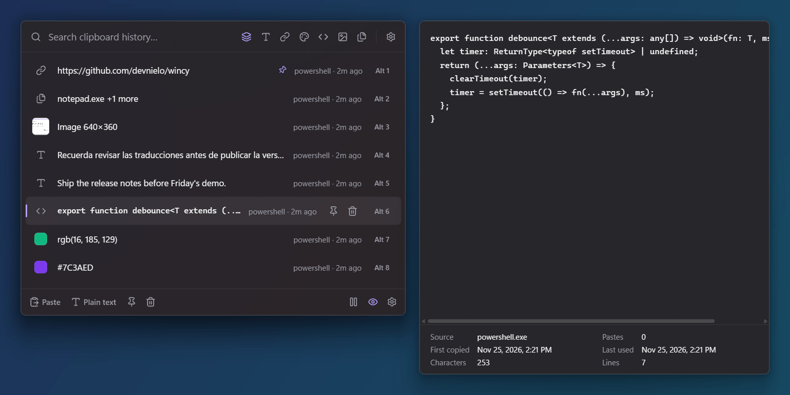

<p align="center">
  
</p>

<h1 align="center">Wincy</h1>

<p align="center">
  <b>The keyboard-first clipboard manager for Windows.</b><br>
  Press <kbd>Alt</kbd>+<kbd>V</kbd>, type, hit <kbd>Enter</kbd>. Fast, private, open source.
</p>

<p align="center">
  <a href="https://github.com/devnielo/wincy/releases/latest"></a>
  <a href="https://github.com/devnielo/wincy/actions/workflows/ci.yml"></a>
  <a href="LICENSE"></a>
  <a href="https://buymeacoffee.com/devnielo"></a>
</p>

<p align="center">
  English · <a href="README.es.md">Español</a>
</p>

<p align="center"></p>

## Features

- **Opens where you are:** a command palette appears next to the mouse cursor, not in a corner of the screen.
- **Everything you copy:** text, rich text (HTML), images, file lists, URLs, colors and code, each detected and labeled automatically.
- **Fuzzy search** across contents and source apps, plus quick kind filters (<kbd>Tab</kbd>) and an `app:` filter (`app:chrome`).
- **Search inside images:** text in screenshots and other copied images is read with the OCR built into Windows, on your PC, so searching finds them too.
- **Paste anywhere:** <kbd>Enter</kbd> pastes straight into the app you were using; <kbd>Shift</kbd>+<kbd>Enter</kbd> pastes as plain text.
- **Quick paste:** <kbd>Alt</kbd>+<kbd>1</kbd>…<kbd>9</kbd> pastes the Nth visible item.
- **Pins** keep snippets forever; they are never trimmed from history.
- **Floating preview panel** beside the palette (right or left, wherever it fits) that shows the hovered or selected clip in full: long text, code, images, colors and file lists, with scrolling.
- **Mouse-friendly:** drag the palette by its search bar, and every shortcut has a button: paste, plain text, pin, delete, pause capture, preview and settings.
- **Private by design:** local only, skips password managers, content marked as sensitive and text that looks like a secret (private keys, API tokens, card numbers); pause capture from the tray, and optionally let old clips expire after a number of days.
- **Light on resources:** event-driven capture (no polling), native Windows vibrancy (Mica / Acrylic), small Tauri binary.
- **Your look:** system, light or dark theme and an accent color (the Windows accent by default, or one of seven others).
- **Automatic, signed updates** and an English / Spanish interface.

## Install

1. Download the latest installer (`*_x64-setup.exe`) from [Releases](https://github.com/devnielo/wincy/releases/latest).
2. Run it. It installs for your user only; no administrator rights needed.
3. Wincy starts in the system tray. Press <kbd>Alt</kbd>+<kbd>V</kbd>.

> **"Windows protected your PC"?** The installer is not signed with a paid code-signing certificate yet, so SmartScreen may warn about it. Click **More info → Run anyway**. If you prefer, [build it yourself](#build-from-source).

Wincy checks for updates on startup (you can turn this off in Settings). Updates are signed and verified before they are installed.

Requires Windows 10 or 11 (x64). WebView2 is already part of Windows 10/11.

## Usage

Copy things as usual. When you need something again, press <kbd>Alt</kbd>+<kbd>V</kbd> (configurable), type a few letters and press <kbd>Enter</kbd>.

### Keyboard shortcuts

| Keys | Action |
|---|---|
| <kbd>Alt</kbd>+<kbd>V</kbd> | Open the palette (global, configurable) |
| *type* | Fuzzy filter by content (including text found in images), source app or kind; `app:name` keeps only clips from that app |
| <kbd>↑</kbd> / <kbd>↓</kbd>, <kbd>PgUp</kbd> / <kbd>PgDn</kbd>, <kbd>Home</kbd> / <kbd>End</kbd> (<kbd>Ctrl</kbd>+<kbd>Home</kbd> / <kbd>End</kbd>) | Move the selection |
| <kbd>Enter</kbd> | Paste |
| <kbd>Shift</kbd>+<kbd>Enter</kbd> | Paste as plain text |
| <kbd>Alt</kbd>+<kbd>1</kbd> … <kbd>Alt</kbd>+<kbd>9</kbd> | Paste the Nth visible item (pins come first, so <kbd>Alt</kbd>+<kbd>1</kbd> is the first pin) |
| <kbd>Ctrl</kbd>+<kbd>P</kbd> | Pin / unpin |
| <kbd>Ctrl</kbd>+<kbd>Delete</kbd> | Delete the item |
| <kbd>Tab</kbd> / <kbd>Shift</kbd>+<kbd>Tab</kbd> | Cycle the kind filter: all → text → url → color → code → image → files |
| <kbd>Ctrl</kbd>+<kbd>Space</kbd> | Show / hide the preview panel |
| <kbd>Ctrl</kbd>+<kbd>,</kbd> | Open settings |
| <kbd>Esc</kbd> | Clear the search; if it is empty, close the palette (in settings: back to the palette) |

The tray icon menu lets you open the palette or settings, pause capture, clear history (pinned items are kept), or quit.

If **Paste into the active app** is turned off in Settings, Wincy only copies the item to the clipboard and you paste it yourself.

If another program already uses your shortcut, Wincy can't register it: it opens Settings with a warning when it starts (the tray tooltip also says the shortcut is unavailable), so you can record a different one.

### Search

Type a few letters of anything in the clip: its text, the text Wincy found in an image, the source app or the kind. Add `app:<name>` to keep only clips copied from apps whose name contains `<name>` (case-insensitive, without `.exe`); repeat it to allow several apps.

| Query | Finds |
|---|---|
| `invoice` | clips containing something like "invoice", including screenshots of one |
| `app:code debounce` | "debounce" in clips copied from VS Code (`Code.exe`) |
| `app:chrome app:edge` | everything copied from Chrome or Edge |

Text in images is recognized in the background with the Windows OCR engine, in one of your Windows display languages; nothing is uploaded. If no OCR language is installed, images are still saved, just not searchable by their text. To turn it off, use Settings → **Recognize text in images**.

## Privacy

Your clipboard history never leaves your computer: no accounts, no cloud, no telemetry. The only network request Wincy makes is the update check against GitHub Releases, which you can disable.

Wincy does **not** capture:

- content that the source app marks as private with the standard Windows clipboard formats `ExcludeClipboardContentFromMonitorProcessing`, `Clipboard Viewer Ignore` or `CanIncludeInClipboardHistory = 0` (Bitwarden, 1Password, KeePassXC and browsers in private mode do this);
- anything copied from an app in the **ignored apps** list. By default: Bitwarden, 1Password, KeePass, KeePassXC, Enpass, Dashlane, LastPass, NordPass and Proton Pass. Add your own in Settings by exe name (e.g. `myvault.exe`);
- text that **looks like a secret** (on by default; Settings → **Ignore secrets**): a PEM private key, a JSON Web Token, AWS access key IDs, GitHub, Slack, Stripe live, Google API, OpenAI and Anthropic keys, or a payment card number (checked with the Luhn algorithm). The check only matches these exact formats, so ordinary text is never thrown away by accident; it is not a guarantee that every secret is caught;
- anything at all while capture is **paused** from the tray menu.

Pinned items are kept until you delete them. Everything else is trimmed to the history size you choose (1000 items by default) and, if you choose a period in Settings → **Delete old clips**, deleted once it hasn't been copied or pasted for that many days (1 to 365; off by default).

### Where your data lives

| What | Where |
|---|---|
| History database | `%APPDATA%\dev.wincy.app\wincy.db` (SQLite) |
| Copied images and thumbnails | `%APPDATA%\dev.wincy.app\images\` |
| Settings | `%APPDATA%\dev.wincy.app\settings.json` (the app config folder) |
| Logs | `%LOCALAPPDATA%\dev.wincy.app\logs\` (rotated at about 1 MB; never contain clip contents) |

**Settings → Open data folder** opens it in Explorer. **Clear history** deletes everything except pinned items. Text recognized in images is stored with the clip in the same database.

## Reporting a bug

Wincy writes a log file (see the table above; Settings → **Open log folder** opens it). Logs record what happened, such as a skipped capture or a failed shortcut, but never what you copied: no clip contents, no recognized text.

When you [open a bug report](https://github.com/devnielo/wincy/issues/new?template=bug_report.yml), click **Settings → Copy diagnostics** and paste the result into it. It contains the Wincy version, Windows version and build, your settings (the ignored apps only as a count), the number of clips, whether OCR is available and the last ~200 log lines. Read it before you post it.

## Uninstall

Windows Settings → Apps → Installed apps → **Wincy** → Uninstall. The uninstaller offers to delete your app data too; to remove it by hand, delete both `%APPDATA%\dev.wincy.app` and `%LOCALAPPDATA%\dev.wincy.app`.

## Build from source

Prerequisites:

- [Rust](https://rustup.rs/) stable with the MSVC toolchain (`x86_64-pc-windows-msvc`; needs the Visual Studio Build Tools "Desktop development with C++" workload)
- [Node.js](https://nodejs.org/) 22.23.4 or newer (current LTS)
- [pnpm](https://pnpm.io/installation)
- WebView2 (preinstalled on Windows 10/11)

```powershell
git clone https://github.com/devnielo/wincy.git
cd wincy
pnpm install
pnpm tauri dev      # run with hot reload
pnpm tauri build    # installer in src-tauri/target/release/bundle/nsis/
```

`pnpm tauri build` signs the updater artifacts, so it needs `TAURI_SIGNING_PRIVATE_KEY`. For a local build, create your own key with `pnpm tauri signer generate -w "$env:USERPROFILE\.tauri\local.key"` and set the variable to the contents of that file. A build signed with your own key will not accept official updates.

## Project structure

```
├── src/                 React + TypeScript frontend (palette, settings)
├── src-tauri/           Rust backend (Tauri v2)
│   └── src/             clipboard listener, SQLite storage, paste, window, tray, settings
├── website/             Astro website (GitHub Pages)
├── assets/logo.svg      master logo (app icons are generated from it)
├── docs/
│   ├── ARCHITECTURE.md  contract between backend and frontend: commands, events, types
│   ├── RELEASING.md     how releases and auto-updates are produced
│   └── SIGNING.md       Authenticode signing through SignPath Foundation
├── packaging/winget/    winget manifest templates
└── .github/             CI, release and Pages workflows, issue templates
```

## Tech stack

- [Tauri v2](https://tauri.app/) and Rust: Win32 clipboard listener (`AddClipboardFormatListener`), [rusqlite](https://github.com/rusqlite/rusqlite) (bundled SQLite), [enigo](https://github.com/enigo-rs/enigo) for paste, [window-vibrancy](https://github.com/tauri-apps/window-vibrancy)
- React 19 and TypeScript, [HeroUI](https://www.heroui.com/), [Tailwind CSS 4](https://tailwindcss.com/), [TanStack Virtual](https://tanstack.com/virtual), [Fuse.js](https://www.fusejs.io/), [Zustand](https://zustand.docs.pmnd.rs/), [Lucide](https://lucide.dev/) icons
- NSIS installer with signed auto-updates via `tauri-plugin-updater`

## Roadmap ideas

Directions, not promises. Open an issue to discuss before starting work.

- Snippets with placeholders (date, cursor position)
- Text transforms before paste (case, trim, JSON format, URL decode)
- Per-app paste rules and an "always plain text" list
- Optional encryption of the history database
- "Center of screen" palette position and multi-monitor options
- Export / import of pinned items
- More languages
- winget and Scoop packages

## Support the project

Wincy is free and open source, and always will be. If it saves you time every day, you can [buy me a coffee](https://buymeacoffee.com/devnielo) — it helps keep the project maintained. Starring the repo and reporting bugs helps too.

## Contributing

Contributions are welcome. Read [CONTRIBUTING.md](CONTRIBUTING.md) for the development setup and conventions, and the [Code of Conduct](CODE_OF_CONDUCT.md). Report security issues privately as described in [SECURITY.md](SECURITY.md). The [changelog](CHANGELOG.md) lists what changed in each release.

## License

[MIT](LICENSE) © 2026 Wincy contributors

## Credits

Inspired by [Maccy](https://maccy.app/) (simplicity), [Raycast](https://www.raycast.com/) (the keyboard-first palette) and [Microsoft PowerToys](https://github.com/microsoft/PowerToys) (Windows power-user tools). Built with [Tauri](https://tauri.app/).
